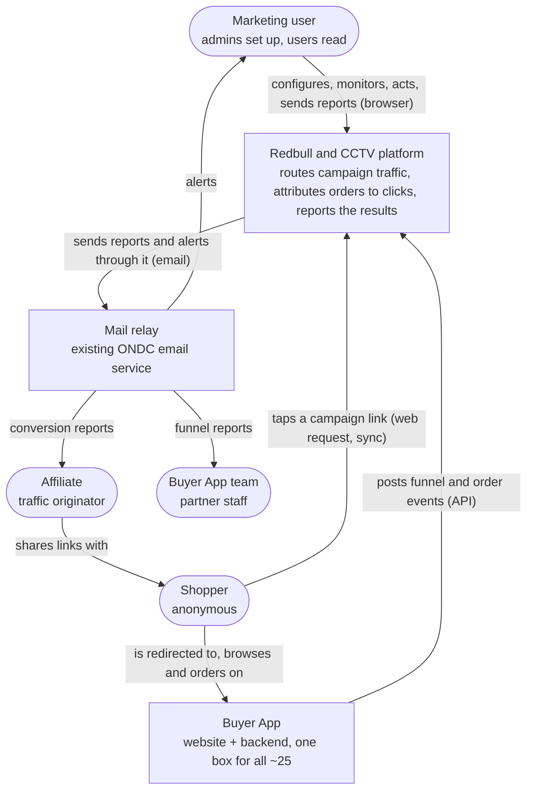
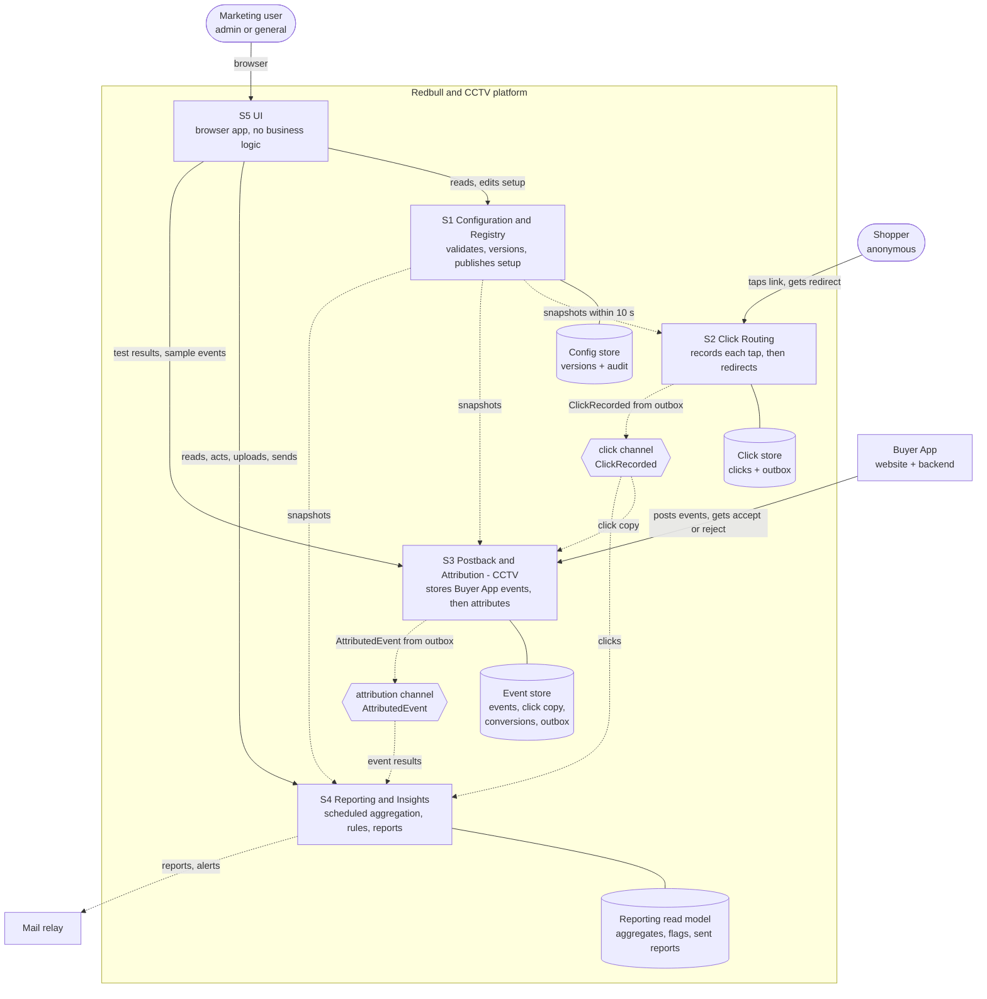
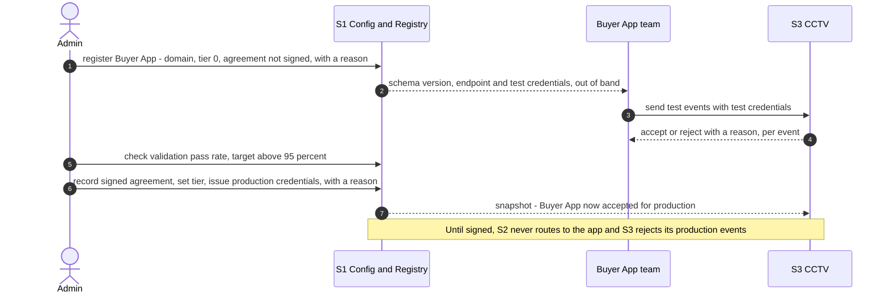
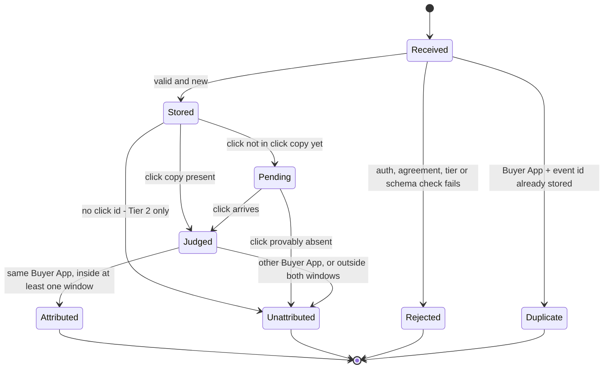
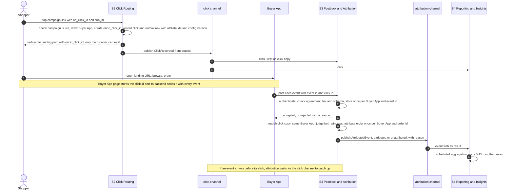
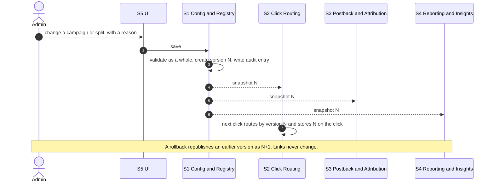
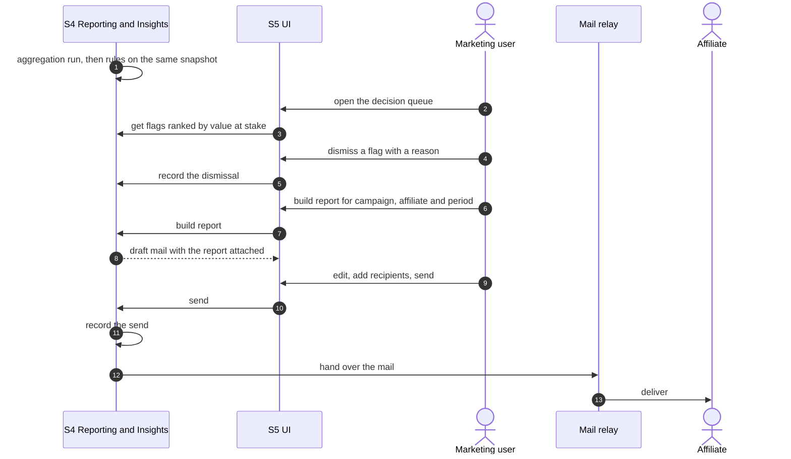

# Redbull & CCTV: architecture understanding

These are working notes covering three things:
1. the architecture draft's decisions, as written;
2. how each service has to work mechanically to meet the requirements;
3. the backend design decisions still open, logged per service with IDs like `D-Sx-nn`.

Anything marked **Proposal** is my suggestion, not a decision. Requirements and requirement-level contradictions (`C-…`) are in [PRD.md](PRD.md). I raise a service's open `C-` and `D-` items when work on that service starts, and we settle them together. Engineering rules for implementation are in `CLAUDE.md`.

Source: `docs/Redbull CCTV — Architecture Design (2).pdf`. All of its ADRs are "Proposed", and it says "technology still to be chosen". Last read in full: 13 Oct 2026.

---

## 1. Architecture style (from the draft)

- **Service-based, with event-driven integration.** Five services, each owning its data, with no shared database. The draft deliberately uses "a small number of services rather than many fine-grained microservices", because splitting further adds network and operational complexity without much extra isolation at this scale.
- **Two kinds of workload:**
  - *real-time*: click routing and Buyer App event ingestion, which must be fast and reliable;
  - *background*: attribution, reporting and analytics, which can run asynchronously and must never block real-time requests.
- **Control plane vs data plane.**
  - Control plane: campaign configuration, Buyer Apps, affiliates and routing rules. Writes are relatively rare.
  - Data plane: CCTV events, clicks, orders and journey events. Write volume is very high; *"we are going to design the write heavy application."*
- **When to talk synchronously.** Only when someone needs an immediate answer: the shopper's redirect, a Buyer App's request, the UI. Everything that can happen later goes over durable events: click propagation, attribution, reporting.
- **Configuration travels as versioned snapshots,** so services keep working while S1 is down.
- **Reporting is computed periodically** into read models every 5–15 minutes, outside the real-time path.
- **Data principle.** *"Every piece of data has one creator and one owning store; every other service works from a copy that arrives along a drawn line. Only two things change: configuration, which changes by adding versions, and figures, which each run recomputes from the facts."*
- **Users, roles and sessions** belong to the shared login capability, not to any of the five services. Each audit record stays with the service that owns the action.
  - **For now (ADR-015) that capability lives inside S1,** in files kept apart from the configuration code, so it can move to its own service later.

## 2. Assumptions and capacity

The draft's assumptions go beyond the PRD's NFRs; the derived figures are mine.

| Assumption (draft) | Derived |
|---|---|
| 500,000 clicks/day, bursts of 200/s | 5.8/s on average, so a burst is ~35× average. About 197M clicks over 13 months |
| 10M Buyer App events/day, peaking at 600/s | 116/s on average. About **3.95 billion** events over 13 months, roughly 2–4 TB raw at 0.5–1 KB per stored event before compression (rough estimate) |
| 15,000 attributed orders/day | About 3% of clicks, consistent with the prototype's 3–4% CVR. About 5.9M conversions over 13 months |
| ~20 events per click | Most of the volume is Tier-2 organic traffic plus browsing |
| Uptime 99.9% for Click Routing and Postback, 99.5% for the rest | 99.9% allows ~44 min of downtime a month; 99.5% allows ~3.6 h |
| 13 months of detail kept | Partition by time and drop expired partitions (D-X-06) |
| ~25 Buyer Apps (C4 context note) | Cohorts of ≥5 per category may be hard to reach early (C-S4-14) |

## 3. Quality attributes → where they bite → tactic

| Quality | Target | Where it bites | Tactic (draft, plus my notes) |
|---|---|---|---|
| Redirect latency | p95 < 300 ms, excluding the Buyer App's page | S2 | Config snapshot held locally; one insert, then redirect; no synchronous call to another service |
| Click durability | Recorded before any response | S2 | Commit the click and its outbox row, then respond. Availability trade-off: D-S2-01 |
| Freshness | ≤ 120 min | S3 → S4 | Async channels plus 5–15 min runs; every view shows an "as of" time (ADR-007) |
| Dashboard speed | < 2 s | S4, S5 | Precomputed read model; no aggregation at request time |
| Counting integrity | Every event and order counted once | S3, S4 | Unique keys (Buyer App + event id; Buyer App + order id); consumers that tolerate redelivery |
| Consistency | One definition per metric; slices reconcile | S4 | One metric layer; every slice computed from the same facts |
| Determinism | Same data gives the same answer, reproducibly | S4 | Rules in code, thresholds versioned; each flag stores its inputs, threshold version and data cut-off |
| Report stability | Re-running a period gives the same conversions | S3, S4 | Report period fixed when the conversion is created |
| Change without release | Config and schema live from the next request; a new Buyer App needs no code | S1, S3 | Config and schemas are data, distributed as snapshots |
| Auditability | Who/when/why on config; sends recorded; dismissal reasons kept | S1, S4 | An append-only audit trail per owning service |
| Security | Every event authenticated; only admins change config | S1, S3, S5 | Enforced in the owning service (ADR-008); Buyer App auth: D-S3-04 |
| Privacy | Agreement gate; Tier 2 off by default; cohort ≥ 5; category level only; no shopper-level data | S1, S3, S4 | Gates in S2 and S3; one disclosure guard in S4 (D-S4-07) |
| Alert timeliness | "Within minutes" (implied) | S4 | **Not covered** by the 5–15 min batch (D-S4-05) |
| Availability, scale, retention | Not specified (draft assumptions above) | All | — |

## 4. System context (C4 level 1, from the draft)

Only the Buyer App calls the platform system-to-system, and the platform calls only the mail relay.



## 5. Containers (C4 level 2, from the draft)

In the diagram, solid arrows wait for a reply; dashed arrows hand off without waiting.



| Container | Responsibility (draft) | Owns |
|---|---|---|
| UI | Marketing's screens for setup, dashboards, flags, reports, claimed-figure uploads and test results. No business logic | — |
| Configuration & Registry | "Rulebook": validates, versions and publishes all setup; rolls back by republishing an earlier version | Config store: campaigns, splits, links, Buyer Apps, affiliates, thresholds, targets, schema versions, audit |
| Click Routing | Resolves the campaign link, checks it's live, draws a Buyer App by weight, creates the ONDC click id, records the click, then redirects | Click store: clicks keyed by ONDC click id, plus the outbox |
| Postback & Attribution (CCTV) | Authenticates the Buyer App; checks agreement, tier and schema; stores the event and answers; attributes it in the background | Event store: events (Buyer App + event id), click copy, conversions (Buyer App + order id), outbox |
| Reporting & Insights | Aggregates every 5–15 min, computes each metric once, runs the rules, builds and sends reports under the disclosure rules | Reporting read model (below) |

The reporting read model has two parts:
- **Rebuildable from the channels:** aggregates, baselines and cohorts.
- **Held only by Reporting:** rule evaluations and flags with their dismissals, claimed figures, and sent reports.

The two channels:
- **Click channel:** `ClickRecorded` for every recorded click, failed routings included.
- **Attribution channel:** `AttributedEvent` for every stored event, with its result.

**Relationships (draft)**

| From → to | What | Style |
|---|---|---|
| Marketing user → UI | Sets up, reads dashboards, acts on flags, uploads claimed figures, sends reports | Sync, browser |
| Shopper → Click Routing | Taps the campaign link; gets the redirect with the ONDC click id | Sync, web request |
| Buyer App → Postback & Attribution | Posts funnel and order events; gets accept or reject with a reason | Sync API |
| UI → Configuration & Registry | Reads and edits setup; only admins may change it | Sync API |
| UI → Reporting & Insights | Reads dashboards and flags, dismisses flags, uploads claimed figures, sends reports | Sync API |
| UI → Postback & Attribution | Buyer App test results and sample events (mentioned in the draft but not drawn) | Sync API |
| Configuration & Registry → S2, S3, S4 | Immutable configuration snapshots | Async, within 10 s |
| Each application → its own store | Reads and writes; the click is written before the redirect | Sync |
| Click Routing → click channel | `ClickRecorded` from its outbox | Async |
| Click channel → S3, S4 | Every click, at least once | Async |
| Postback & Attribution → attribution channel | `AttributedEvent` from its outbox | Async |
| Attribution channel → S4 | Every event with its result, at least once | Async |
| Reporting & Insights → mail relay | Partner reports and outage alerts | Async |

## 6. Data: who creates it, who owns it, who reads it (from the draft)

| Data | Created by | Owned by | Read by, and how |
|---|---|---|---|
| Configuration: Buyer Apps, campaigns, splits, landing paths, windows, commission, thresholds, targets | An admin's save in the UI, checked as a whole by S1 | Config store | S2, S3, S4 from their own snapshot, pushed within 10 s; the UI through S1's API |
| Event schema | S1, published once | Config store | S3's validator, through the snapshot; each Buyer App builds against it once, at onboarding |
| Campaign link (one per campaign per affiliate) | S1, when the campaign is activated | Config store | The affiliate, who gets it from Marketing; S2, which resolves it from its snapshot |
| The affiliate's `aff_click_id` and `sub_id` | The affiliate, appended to the link | Click store, on the click, exactly as received | S3 and S4 through the click channel; the affiliate gets them back in its report |
| Click record | S2, on every tap, before the redirect | Click store | S3 (keeps a click copy) and S4, both through the click channel |
| ONDC click id | S2, one per click | Click store (it's the click's key) | The Buyer App, through the redirect; its page keeps it on its own domain and sends it back with every event |
| Events: landing, product view, category view, add to cart, checkout started | The Buyer App's backend, with its own event id | Event store, once per Buyer App + event id, stored before the answer | The Attributor in the same container; S4, with the event's result, through the attribution channel |
| Order (the `order_confirmed` event) | The Buyer App's backend | Event store, once per Buyer App + order id, with value, items and categories | The Attributor; S4 through the attribution channel |
| Event result: attributed or not, with the reason | The Attributor, in the background, once per stored event | Event store | S4 through the attribution channel |
| Conversion | The Attributor, when an order matches a click from the same Buyer App inside **at least one** window | Event store, at most one per Buyer App + order id, **with its report period fixed then** | S4 through the attribution channel, for figures and affiliate reports |
| Order status update (cancelled or returned) | The Buyer App's backend | Event store | S4 through the attribution channel, for the completed vs cancelled/returned share |
| Figures: funnels, conversions, category match, GMV, commission, ROI, baselines, the daily affiliate view | S4, every 5–15 min | Reporting read model | The UI through S4's API; the rules and reports inside S4 |
| Flag and its dismissal | S4's rules after each run, with inputs and threshold version stored | Reporting read model | The UI's decision queue, ranked by value at stake |
| Report and its send record | S4, when Marketing builds and sends a report in the UI | Reporting read model | The affiliate or Buyer App by email through the mail relay; Marketing in the send history |

## 7. Channels and message contracts

The draft names two channels, plus config snapshots (called `ConfigPublished` in the early data-model diagram). Delivery is **at least once**, so every consumer must be idempotent.

**Proposal: payload fields** (to settle when we work on the producing service)

| Message | Key | Fields |
|---|---|---|
| `ConfigPublished` | snapshot version | `version`, `published_at`, `published_by`, `reason`, `changed[]` (aggregate + revision), plus the snapshot body or a reference to it (D-S1-02/03). Never secrets |
| `ClickRecorded` | `click_id` | `click_id`, `recorded_at`, `link_code`, `campaign_id`, `affiliate_id`, `buyer_app_id` (null when not routed), `routing_status`, `failure_reason`, `aff_click_id`, `sub_id`, `config_version`, the attribution parameters stamped at click time (`internal_window_days`, `contract_window_days`, `promoted_category`, commission scheme ref; D-S2-03), `suspected_bot` |
| `AttributedEvent` | `buyer_app_id` + `event_id` | Identity and timing (`event_name`, `occurred_at`, `received_at`, `click_id`); `result` (attributed / unattributed) with `reason_code`; `campaign_id`, `affiliate_id`, `buyer_app_id`; the stage payload (sku, category, qty, price, cart value…); for orders: `order_id`, `order_value`, the item value per category, the category-match value, `in_internal_window`, `in_contract_window`, `report_period`, `conversion_id`; for status updates: `order_id`, `status`, `reason` |

---

## 8. Service designs (backend view)

### 8.1 S1: Configuration & Registry

**What the draft fixes:**
- S1 is the "rulebook". It owns the config store.
- Campaign and Buyer App configuration live together and are versioned together (ADR-002).
- Configuration is published as immutable snapshots, and a rollback republishes an earlier version as N+1 (ADR-004).
- The flow: an admin's change, with a reason → validate as a whole → version N plus an audit entry → snapshot N to S2, S3 and S4 → the next click routes by version N and stores N on the click.

**Write path (Proposal)**
1. Each command carries a mandatory `reason` (S1-09).
2. Authorise: the user must be an admin (S5-01), checked here, not in the UI.
3. Load the aggregate at its expected revision (optimistic concurrency; D-S1-06) and apply the change.
4. Validate the **whole** affected configuration, not just the field that changed (S1-08).
5. In one transaction, write the new revision, the audit entry (who, when, what changed before/after, why), the new snapshot version, and an outbox row for `ConfigPublished`.
6. A relay publishes the snapshot; consumers swap to it atomically.

**Validation catalogue** (from the PRD; "when" means when the rule is enforced)

| Rule | When | Source |
|---|---|---|
| Splits are whole basis points and total 100% | Save | S1-06 |
| An app with a share above zero must be signed and at an eligible tier | Save | S1-07 (tier: C-S1-02) |
| Every app with a share has a well-formed landing path (starts with `/`, no host) | Activate | S1-01, S1-08 |
| At least one affiliate; each has a commission rate (flat or AOV-tiered) | Activate | S1-03, S1-18 |
| Window within bounds; defaults from the category | Save | S1-02 (bounds: C-S1-03) |
| Link codes are unique and never change once minted | When the pairing is created | Invariant 3 |
| Enabling Tier 2 needs a second approval | Registry change | S1-13 (C-S1-11) |
| A rollback target is **re-validated against today's registry** (an agreement may have been terminated since) | Rollback | Proposal |

**Snapshot contents per consumer (Proposal)**
- **S2:**
  - `link_code` → campaign, affiliate, channel, status (one link per affiliate × channel, prototype v3);
  - the routing list (Buyer App, weight, destination base URL = domain + landing path, availability);
  - the attribution parameters to stamp on clicks (D-S2-03);
  - the version.
- **S3:**
  - per Buyer App: agreement status, tier, accepted schema version(s), and its verification keys (public keys or key ids only, never shared secrets: D-S1-04);
  - the compiled event schemas;
  - the category taxonomy, if category match is computed in S3 (D-S3-06).
- **S4:**
  - categories (floors, timing profile), thresholds and their version, targets;
  - campaigns (name, category, status, ROI-floor override, cost inputs), affiliates (name, contract window), channels (name, for per-channel results), Buyer Apps (name, tier, for disclosure);
  - commission schemes.

**Buyer App onboarding (Proposal flow, built from the requirements)**



**Entities (Proposal; fields still to be settled).** The team's data model in `docs/data_model-S1` is the authority; where the two differ, the data model wins.
- **Buyer App:**
  - `buyer_app`: code, name, domain, data tier (0/1/2), agreement status (not signed / signed / suspended / terminated), when signed, Tier-2 addendum reference, accepted schema version, mobile readiness (informational), availability flag.
  - `buyer_app_credential`: key id, kind (test / production), verification key, status, created and rotated times.
- **Reference data:**
  - `category`: **built** (task 1, ADR-011). It has a UUID `_id`, a `name` unique ignoring letter case, `defaultWindowDays` (1–60, default 7), `aliases` (one category per alias), `currentVersionNo`, `createdAt` and `updatedAt` (camelCase, per the team naming standard in ADR-010). Its API is in `docs/api/openapi.yaml`. Floors and the timing profile are left for the thresholds work.
  - `channel`: **built** (task 2, ADR-013).
    - A place where an affiliate posts its tracking link (WhatsApp, Telegram, …).
    - Fields: UUID `_id`; `name`, unique ignoring letter case (1–50 characters); `currentVersionNo`; timestamps. Lists are sorted by name; there's no display-order field.
    - Search by name: `?search=` matches the text anywhere in the name, ignoring letter case. That's a scan of the collection, which is fine for a short list.
    - Not to be confused with the message channels in §7.
  - `affiliate`: **built** (task 3, ADR-014).
    - Fields:
      - UUID `_id`;
      - `code`, generated by the server for tracking links and unique ignoring letter case; it never changes, not even on a rename;
      - `name`, unique ignoring letter case;
      - `contactEmail`, `defaultCommissionRatePercent` and `defaultContractWindowDays`; the last two prefill campaigns;
      - `status` (`active` or `paused`), plus `currentVersionNo` and timestamps.
    - A paused affiliate can't be added to new campaigns. Pause and resume are a PATCH of `status`.
    - The list can be searched by name and filtered by status.
- **Campaign:**
  - `campaign`: code, name, description, category, promoted category node, status, window override, ROI-floor override, cost inputs, AOV bucket scheme.
  - `campaign_buyer_app`: weight in basis points, landing path.
  - `campaign_affiliate`: channels (at least one, stored as `channelIds`), a link code per affiliate × channel (unique, immutable), commission scheme (flat rate or AOV tiers), status.
- **Rulebook:**
  - `thresholds`: global, per category, versioned.
  - `affiliate_target`: affiliate, month, order target.
  - `event_schema_version`: version, JSON Schema per event, when published, deprecated and retired.
- **History:**
  - `config_version`: sequence number, who, when, reason, the changes, a snapshot hash.
  - `audit_entry`.

**Open design decisions (S1)**
- **D-S1-01 · Versioning granularity and rollback scope.** If one global version covers all config, rolling back campaign A's split to N−3 would also undo campaign B's changes made since. *Proposal:* revisions per aggregate (campaign, Buyer App, thresholds), plus one global, ever-increasing snapshot number for distribution. A rollback copies an old aggregate revision forward and is re-validated.
  - **Decided by the data model:** `config_versions` holds per-item versions (`item_type`, `item_id`, `version_no`) with a globally unique `publish_seq`.
  - **Still to design in the versioning task:** re-validating a rollback against the current registry, and the transaction, which needs a replica set (ADR-009).
- **D-S1-02 · Snapshot distribution and bootstrap.** Options: a compacted topic, S2/S3/S4 polling S1 with an ETag, or snapshots in an object store. Each service needs a durable "latest" snapshot so it can **start while S1 is down**. The PRD's "next request" (S1-11) really means "within ~10 s" (raised against ADR-004).
- **D-S1-03 · Snapshot shape.** One full snapshot, or a projection per consumer. Either way, no secrets.
  - **Decided by the data model:** `config_snapshots` stores one slice per consumer (`s2`, `s3`, `s4`) per `publish_seq`, with a checksum.
- **D-S1-04 · Buyer App credentials.** Options: HMAC shared secrets (must then be kept out of snapshots), asymmetric request signing (S1 distributes public keys only), or mTLS. Plus rotation with overlapping keys, and test vs production keys. Decided together with D-S3-04.
- **D-S1-05 · Schema registry format.** *Proposal:* JSON Schema per event per version, stored as data and compiled once per snapshot in S3, so a new version needs no release (S1-04).
- **D-S1-06 · Concurrent admin edits.** *Proposal:* optimistic locking: an expected-revision / `If-Match` check, returning 409 on conflict.
  - **Resolved (ADR-010, ADR-011):** each item's `currentVersionNo` is sent as its `ETag`, and PATCH/DELETE accept an optional `If-Match`.
  - A stale `If-Match` returns **412**, the standard HTTP status for a failed precondition, not 409.
  - Each update is one atomic MongoDB operation with the version in its filter.
- **D-S1-07 · Link-code scheme.** Readable (`CAMP-2026-0089-CK`) or opaque; uniqueness; minted once. Follows C-S1-07.
- **D-S1-08 · Tier-2 approval mechanism.** Follows C-S1-11.
- **D-S1-09 · Config store technology.** Relational, with low writes and strong constraints; PostgreSQL is the obvious candidate.
  - **Resolved (ADR-009):** MongoDB (a team decision), accessed through Mongoose. Unique indexes enforce uniqueness rules.
  - Transactions will need a replica set.

### 8.2 S2: Click Routing

**What the draft fixes:**
- S2 resolves the link, checks the campaign is live, draws a Buyer App by weight, creates the ONDC click id, and records the click plus an outbox row (with the affiliate's ids and the config version) **before** redirecting.
- `ClickRecorded` is published from the outbox, failed routings included.
- S2 has no runtime dependency on S1, thanks to its local snapshot.

**Request pipeline (Proposal):** `GET /c/{link_code}?aff_click_id=…&sub_id=…`
1. **Parse and bound** `aff_click_id` and `sub_id`: length and character set. Store them as received but bounded. Keep a bounded copy of any other parameters (C-S2-09).
2. **Resolve** the link code in the in-memory snapshot (no network call). If unknown, log an invalid-link hit and show a neutral page (C-S2-05).
3. **Check status**: campaign live and affiliate active. If not, record the click with a status and show a neutral page (C-S2-05).
4. **Draw** over the **configured** split (D-S2-06), *then* check the drawn app's availability.
   - Leaving unavailable apps out of the draw would quietly give their share to the others, which is exactly the automatic re-route S2-07 forbids.
   - If the drawn app is unavailable: record a failed click (with reason), show a failure page, and don't retry another app.
5. **Mint the click id** (D-S2-02).
6. **Build the destination**: `https://{domain}{landing_path}`, appending `ondc_click_id`. Respect any query string the path already has, and URL-encode. Forward nothing else (S2-03).
7. **One transaction:** insert the click and the outbox `ClickRecorded` row, then **commit** (S2-01).
8. **Respond** with a `302` to the destination, `Cache-Control: no-store`.
9. **Relay:** the outbox is published to the click channel asynchronously, keyed by `click_id`.

**Click record (Proposal)**
- `click_id` (primary key), `link_code`, `campaign_id`, `affiliate_id`, `buyer_app_id`.
- `routing_status` (routed / failed_unavailable / not_live / no_eligible_app), `failure_reason`.
- `aff_click_id`, `sub_id`, `extra_params` — all bounded.
- `config_version` and the stamped attribution parameters (D-S2-03).
- `recorded_at`.
- `user_agent` (bounded), a truncated, salted hash of the IP (for fraud analysis only), `suspected_bot`.

The table is partitioned by month and dropped after the retention period.

**Failure handling (Proposal; behaviour is open in C-S2-05)**

| Situation | Shopper sees | What's recorded |
|---|---|---|
| Unknown link code | Neutral "link not found" page | Invalid-hit log (not a campaign click) |
| Campaign not live (Draft / Paused / Ended / Archived) | Neutral page | A click with `not_live` |
| Affiliate removed or paused on the campaign | Open: route anyway (the link must stay valid) or neutral page? | A click with its status |
| Drawn app unavailable | Failure page; no re-route | A click with `failed_unavailable`, counted against the campaign |
| Click store unavailable | D-S2-01 | — |
| No snapshot at boot | The instance reports not-ready and receives no traffic | — |

**Latency budget (Proposal).** The server-side target is ~30 ms at p95 (snapshot lookup, random draw, one synchronous insert). The rest of the 300 ms goes to network and TLS. Keep the database in the same region, use a connection pool, and make no external calls.

**Open design decisions (S2)**
- **D-S2-01 · Durability vs availability.** "Written to the database before any response" plus "never lose a click" means a click-store outage blocks every redirect. Options:
  - **fail closed:** show an error page; the affiliate traffic is lost;
  - **a local durable spool:** an append-only log on the instance, drained into the database later. This keeps redirects flowing, but stretches the meaning of "the database".

  Pairs with the 99.9% availability target.
- **D-S2-02 · Click id format.** *Proposal:* a 128-bit, time-ordered id (UUIDv7 or ULID) plus a short MAC computed with an S2 key; URL-safe; under ~40 characters. It lets S3 reject forged ids without a lookup and know when the click happened before the click copy arrives, which bounds the wait in ADR-005.
- **D-S2-03 · Stamp attribution parameters on the click.** The windows, promoted category and commission scheme in force at click time are copied onto the click and carried in `ClickRecorded`. Then S3 never needs historical config versions, and rollbacks, window edits and removed apps can't change how an existing click is judged. The alternative is that S3 keeps every snapshot version and looks it up by `config_version`.
- **D-S2-04 · Outbox relay and channel technology.** Polling with `FOR UPDATE SKIP LOCKED`, or change-data capture. The broker choice is D-X-02.
- **D-S2-05 · Classifying bots and link previews at click time.** User-agent lists (WhatsApp, Telegram, Slack, Facebook unfurlers, crawlers) plus behavioural signals. Record everything; mark suspected bots; exclude them from metrics.
- **D-S2-06 · Draw algorithm.** A cryptographically random weighted draw, or smooth weighted round-robin (accurate within a few clicks, but stateful per instance). Stickiness via a router cookie, if C-S2-04 says yes.
- **D-S2-07 · Deployment.** Its own deployable, stateless, horizontally scaled, with a highly available primary database. Health checks: the snapshot is loaded and the database is reachable.

### 8.3 S3: Postback & Attribution (CCTV)

**What the draft fixes:**
- S3 authenticates the Buyer App; checks agreement, tier and schema; stores the event once per (Buyer App, event id) **before** answering; and answers accept or reject with a reason.
- An Attributor in the background matches the click copy (same Buyer App), judges both windows, and attributes each order at most once per (Buyer App, order id), fixing its report period at that moment.
- It publishes `AttributedEvent` for every stored event. An event that arrives before its click **waits** for the click (ADR-005).

**Ingest pipeline, synchronous (Proposal):** `POST /v1/events`
1. Enforce a size limit and require JSON.
2. **Authenticate** (D-S3-04): resolve the key id to a Buyer App and credential kind (test / production); verify the signature and timestamp within a replay window.
3. **Agreement gate:** production credentials need a signed agreement (S1-12). Test credentials go to test mode (D-S3-08).
4. **Validate** against the Buyer App's schema version: known `event_name`, required fields, types, the unknown-field policy (C-S3-13), money format, timestamp bounds (C-S3-08).
5. **Tier gate:** no `click_id` and tier below 2 → reject with `TIER_REQUIRES_CLICK_ID` (Tier-1 status updates: C-S3-03).
6. **Sanity-check the click id** if ids are signed (D-S2-02).
7. **One transaction:** insert the event (deduplicated on Buyer App + event id; D-S3-02) and queue it for attribution.
8. **Respond:**
   - `202 {status:"accepted"}`;
   - `200 {status:"duplicate"}` for a redelivery. This is idempotent success, so the Buyer App stops retrying; it is not a rejection;
   - `4xx {status:"rejected", reason_code, detail}`.

   Rejected attempts go to a bounded log for validation metrics (D-S3-10).

Proposed reason codes: `AUTH_FAILED`, `AGREEMENT_NOT_SIGNED`, `SCHEMA_VERSION_RETIRED`, `UNKNOWN_EVENT`, `INVALID_PAYLOAD`, `TIER_REQUIRES_CLICK_ID`, `CLICK_ID_INVALID`, `TIMESTAMP_OUT_OF_RANGE`, `PAYLOAD_TOO_LARGE`.

**Attribution, asynchronous (Proposal)**

```text
for each stored event e (Buyer App B, event id, name, click id c, occurred_at t):
  if c is absent:                  result = unattributed(NO_CLICK_ID)          # Tier 2 only (S3-07, S3-17)
  elif no click copy k for c yet:  park e as pending(c)                       # ADR-005; ends per D-S3-01
                                   -> when the click arrives: judge
                                   -> when the click is provably absent: unattributed(CLICK_NOT_FOUND)
  elif k.buyer_app != B:           result = unattributed(BUYER_APP_MISMATCH)  # S3-16
  else:
    in_internal = k.recorded_at <= t <= k.recorded_at + k.internal_window     # parameters stamped on the click (D-S2-03)
    in_contract = k.recorded_at <= t <= k.recorded_at + k.contract_window     # tolerance for skew: C-S3-08
    if name == order_confirmed:
      if a conversion exists for (B, order_id): no change; count as a data-quality item (S3-09, C-S3-16)
      elif in_internal or in_contract:
           create the conversion (in_internal, in_contract, category breakdown, category-match value,
                                  report_period = period_of(now))             # D-S3-06, C-S4-17
           result = attributed
      else: result = unattributed(OUTSIDE_WINDOWS)
    elif name == order_status_update: link it to the conversion by (B, order_id), or park until the order arrives
    else: attribute the funnel event to k's campaign, affiliate and app (window rule for funnel events: C-S3-07)
  publish AttributedEvent(e, result) through the outbox
```



**Storage (Proposal)**
- **`event`:** partitioned by receive date. Normalised columns plus the validated payload.
- **Event deduplication:** a separate `event_key` table on (Buyer App, event id). A unique index on a time-partitioned table must include the partition key, so it would miss a redelivery that arrives on a different day (D-S3-02).
- **`click_copy`:** keyed by `click_id`, kept for the longest window plus slack.
- **`conversion`:** unique on (Buyer App, order id). Holds both window flags, the category breakdown and the report period.
- **`order_status`:** linked to its conversion.
- **`pending_attribution`**, the **outbox**, and the bounded **`rejected_attempt`** log.

**Open design decisions (S3)**
- **D-S3-01 · When to stop waiting for a click.** ADR-005 marks an event "unknown only with sufficient evidence" but never defines it, and it rejected a fixed timeout. *Proposal:* with signed, time-ordered click ids (D-S2-02), a click is provably absent once the click-channel consumer has passed the click's creation time plus the maximum publish delay. Monitor the age of pending events (an ADR-005 cost).
- **D-S3-02 · Deduplication with a time-partitioned store.** A separate key table with retention ≥ the maximum redelivery horizon, or partition by Buyer App instead of time.
- **D-S3-03 · Event store technology and layout.** Roughly 4 billion rows over 13 months; partitioning, compression, keeping the raw payload (and for how long), and dropping old partitions.
- **D-S3-04 · Ingest authentication and replay protection.** A signature over the body and a timestamp, a key id header, a ±5 min window, key rotation, and rate limits per Buyer App. Decided with D-S1-04.
- **D-S3-05 · Ingest API shape.** Single events only, or also batches (partial acceptance per item); status codes; reason codes; size limits.
- **D-S3-06 · Where category match and report period are computed.** The PRD hop table puts category match on the S3 → S4 hop, and the draft fixes the period when the conversion is created. *Proposal:* both in S3, at conversion creation; S4 only aggregates.
- **D-S3-07 · Attribution worker concurrency.** Process each click id one at a time (e.g. partition by `click_id`) so an order and its status update for the same click can't race; results must be idempotent.
- **D-S3-08 · Test mode.** Separate credentials and storage; the same validation code; never attributed; it feeds the >95% pass-rate metric.
- **D-S3-09 · Normalising money and time.** ONDC payloads carry decimal strings; store integer paise. `occurred_at` is ISO-8601 with an offset; store UTC.
- **D-S3-10 · Rejected-event log.** Keep the reason, the Buyer App and a hash of the payload for N days. It feeds the per-app pass rate shown on the Buyer App page.

### 8.4 S4: Reporting & Insights

**What the draft fixes:**
- S4 consumes the click and attribution channels plus config snapshots.
- Every 5–15 min it aggregates into its read model, computes each metric once, and **then runs the rules on the same data** (the early sequence diagram says "on the same snapshot").
- It builds reports and sends them through the mail relay under the disclosure rules.
- It records flags (with inputs and threshold version), dismissals, claimed figures and sent reports.
- Every view shows when its data is as of (ADR-007).

**Read-model layers (Proposal)**
1. **Fact intake.** Consumers upsert click facts and event facts idempotently, keyed by message key.
2. **Daily figures,** per IST day × campaign × affiliate × Buyer App × category:
   - clicks, landings, reach at each stage;
   - conversions (internal / contractual);
   - GMV, item value per category, commission;
   - completed, cancelled and returned orders;
   - low-ticket orders.

   The **daily affiliate figures** are derived from these; the pacing, concentration, reconciliation and ticket-size rules read them, with no separate pipeline (S4-18).
3. **Metric layer.** One module implementing the PRD §11.2 definitions. Dashboards, rules and reports all call it (S4-01).
4. **Rule run.** Pure functions of (metric values, threshold version) → flag candidates, carrying the observed values, threshold, scope and value at stake.
5. **Flags.** Each flag has a stable identity, a lifecycle and dismissals (D-S4-03).
6. **Reports and sends.** Immutable artifacts plus send records (D-S4-06).
7. **Cohorts and baselines,** aware of tiers and passed through the disclosure guard (D-S4-07).

**One run (Proposal)**
1. Pin a watermark: the channel offsets consumed so far, plus the snapshot version.
2. Recompute only the affected days.
3. Compute the metrics, then evaluate the rules at the same watermark and the current threshold version.
4. Upsert flags and close those whose condition has cleared.
5. Record the run's id, duration and "as of" time.

To keep runs deterministic: sort tie-breaks stably and fix the rounding rules.

**API for the UI (Proposal, all synchronous; reads hit precomputed data so they return in under 2 s)**
- Campaign list with KPIs; campaign report; funnel slices (everyone / by affiliate / by Buyer App).
- Affiliate list; the affiliate daily view; network "today at a glance".
- Decision queue ranked by value at stake; flag detail ("why this fired"); dismiss with a reason; rule health.
- Reports: build → draft → edit → send → history.
- Claimed-figure upload.
- Export, and saved view state for shareable links (S4-05).

**Open design decisions (S4)**
- **D-S4-01 · Read-model store and grain.** PostgreSQL, or a columnar store (e.g. ClickHouse), for the daily-figure fact tables. Volumes favour a columnar store for event-level facts; Postgres may be enough if S4 keeps only the daily grain.
- **D-S4-02 · Run orchestration.** Scheduler, incremental recompute, watermarks, how freshness is exposed, and what happens when a run overlaps the next or fails.
- **D-S4-03 · Flag identity and lifecycle.**
  - *Proposal:* identity = rule code + scope ids + period.
  - States: open → dismissed (with reason, by whom, when), or resolved (cleared in a later run), with defined re-opening rules.
  - Dismissal rate = dismissed ÷ opened, per rule, over a trailing window.
  - Without a stable identity, re-firing every 5–15 minutes would inflate the fire counts.
- **D-S4-04 · Value-at-stake formulas.** Once C-S4-04 settles the unit: one documented formula per rule, computed in the rule.
- **D-S4-05 · Outage alerts.** The checkout → order break per Buyer App must alert within minutes, which the batch can't do. Options:
  - S3 keeps rolling counts and emits an "outage suspected" signal;
  - a 1-minute S4 job over the attribution channel;
  - a separate small consumer.

  Also: delivery (mail relay or other channel: C-S4-11), suppression of repeats, and recording.
- **D-S4-06 · Report artifacts and mail.** Format (CSV / XLSX / PDF), **escaping against CSV injection** (`aff_click_id` and `sub_id` are untrusted, e.g. a value starting with `=`), immutable storage with a content hash, templates for subject and body, the mail-relay protocol, retries, and delivery status on the send record.
- **D-S4-07 · Disclosure guard.** One module that every Buyer-App-facing output must pass through:
  - category-level only;
  - cohort ≥ 5 excluding the recipient (C-S4-14);
  - median that excludes the recipient;
  - no names or ids of other apps;
  - no SKU, seller or provider fields;
  - the recipient's tier entitles it to the output.
- **D-S4-08 · Rebuildability.** The draft says aggregates can be rebuilt from the channels. That needs either 13 months of channel retention or a re-export path from the S2/S3 stores.
- **D-S4-09 · Claimed-figures upload.** CSV layout, validation, provenance (uploaded by, when, file hash), and corrections (whether a new upload replaces or adds to the previous one).
- **D-S4-10 · Dashboard latency and shareable views.** Precomputed summaries, caching, and saved view state behind a short link.

### 8.5 S5: UI

**What the draft fixes:** a thin client with no business logic (ADR-008). It calls:
- S1 to read and edit setup;
- S4 to read dashboards and flags, act on flags, upload claimed figures, and build and send reports;
- S3 for Buyer App test results and sample events.

Every service enforces authentication, authorisation and validation itself, so the UI can't be used to bypass the rules.

**Open design decisions (S5)**
- **D-S5-01 · Identity provider and roles.** The "shared login capability": which identity provider (an ONDC SSO?), how admin / general roles are carried in tokens, how tokens propagate to the services, and how sessions expire.
  - **Partly resolved (ADR-015, ADR-016):**
    - S1 hosts users and login for now.
    - Roles `admin` / `user` travel in the `role` claim of an RS256 JWT, signed with S1's private key.
    - Any service can check that token with the public key, without calling S1.
    - Logout ends one session in S1: the token's id is revoked until the token expires (ADR-016).
  - **Still open:**
    - how S2–S4 get the public key (a configured file or a JWKS endpoint);
    - the token lifetime (60 minutes for now) and refresh tokens;
    - how S2–S4 learn about revoked (logged-out) tokens;
    - whether an ONDC SSO replaces S1's login later.
- **D-S5-02 · A backend-for-frontend (BFF) or gateway, or direct calls.** The UI coordinates calls across services (an ADR-008 cost). A thin BFF can aggregate them and keep tokens out of the browser.

---

## 9. Key flows

### 9.1 Click to attributed order (from the draft)



### 9.2 Configuration change and rollback (from the draft)



### 9.3 Decisions and partner reports (from the draft)



### 9.4 Buyer App onboarding (Proposal)
See the diagram in §8.1.

## 10. ADRs in the draft (all "Proposed") and my notes

| ADR | Decision | Alternatives rejected | Consequences the draft names | My notes |
|---|---|---|---|---|
| 001 | Five independently deployable services (S1–S5) | A single application (reporting load and releases could affect the click path); finer-grained services | **+** independent scaling and deployment, clear ownership, failure isolation. **−** more to deploy, monitor and secure; communication between services must be designed explicitly | The boundaries match the PRD. Deployment can be phased: S2 and S3 have the strictest SLOs, so they isolate first (D-X-01) |
| 002 | S1 owns the Buyer App registry **and** campaign configuration, versioned together | Separate registry and campaign services | A campaign is validated against Buyer App data within one boundary; versions and rollback stay consistent | Agree. Version per aggregate, not with one global number, so a rollback doesn't undo unrelated changes (D-S1-01) |
| 003 | Each service owns its data; no direct access to another's database | A shared database | **+** clear ownership, independent schemas and scaling. **−** data must be replicated; cross-service consistency must be designed | The copies: S3's click copy, S4's facts. Matches `CLAUDE.md` §2 |
| 004 | Immutable, versioned config snapshots; S2, S3 and S4 keep their own copy; each click records the version; a rollback republishes an earlier version | Reading S1 on every request; reading S1's database | **+** clicks don't depend on S1; config is reproducible from the version; explicit rollback. **−** a short propagation delay | "Next request" becomes "within ~10 s". Needs bootstrap without S1 (D-S1-02); rollbacks re-validated (D-S1-01); click-time parameters (D-S2-03) |
| 005 | An event that arrives before its click is stored, then waits for the click; marked unknown only with sufficient evidence | Reject it; mark it unattributed at once; query S2 synchronously; a fixed timeout | **+** protects attribution correctness; keeps data ownership intact. **−** needs a waiting/reconciliation mechanism and monitoring of how long events wait | "Sufficient evidence" is undefined: D-S3-01 |
| 006 | Asynchronous channels: S2 → S3 and S2 → S4 (clicks), S3 → S4 (attribution); consumers keep their own copies | Direct database access; a synchronous lookup per event; one shared bus without channel ownership | **+** producers don't wait; consumers catch up after failures; services deploy independently. **−** eventual consistency; infrastructure for delivery and replay | At-least-once delivery means consumers must tolerate duplicates. Keep per-key ordering. Retention for replay and rebuild: D-S4-08 |
| 007 | Scheduled aggregation into S4's read model; the UI reads prepared data | Computing metrics on each dashboard request; a real-time streaming pipeline | **+** fast, consistent reads; reusable calculations; deterministic. **−** eventual consistency; every view must show when its data is as of | Outage alerts need a faster path: D-S4-05 |
| 008 | A thin UI; business validation, authorisation and data ownership stay with the owning services | Rules only in the UI | **+** one authoritative place for rules; non-UI access is protected; no duplicated logic. **−** the UI may coordinate calls across services | A BFF option: D-S5-02 |

## 11. Cross-cutting concerns

- **Identity and access.**
  - The shared login capability issues identities with roles (admin / general); every service checks them itself (ADR-008).
  - **Built in S1 (ADR-015):**
    - users stored with bcrypt password hashes;
    - login returns a 60-minute RS256 JWT;
    - 5 wrong passwords lock an account for 15 minutes;
    - S1 refuses tokens of disabled users, tokens issued before a password change, and logged-out tokens (ADR-016);
    - every response is `Cache-Control: no-store`.
    - ⚠ Forgot password has no verification yet (an accepted risk, to be fixed before production).
  - Service-to-service authentication: D-X-03.
  - Buyer Apps authenticate per request: D-S3-04.
- **Audit.** Append-only, kept by the owning service:
  - S1: every config change (who, when, what, why);
  - S4: dismissals, report sends, claimed-figure uploads;
  - S3: credential use and rejections, kept in the bounded log.
- **Privacy.**
  - No shopper identity anywhere.
  - The click keeps the user agent and a truncated, salted IP hash only for fraud work; India's DPDP Act 2023 argues for minimal personal data.
  - Event schemas keep free-text fields short.
  - No shopper-level data in outputs; Buyer-App-facing reports go through the disclosure guard (D-S4-07).
- **Observability** (D-X-04). What to measure, per service:
  - S2: redirect latency; clicks by routing status.
  - Outbox and channel lag.
  - S3: events accepted or rejected, by reason and by Buyer App; age of pending attributions.
  - S4: run duration and freshness (as-of lag); flags per rule and dismissal rates.
  - Mail sends by status; outage-alert latency.
- **Retention.** The draft assumes 13 months (OQ-08): time-partitioned stores, with expired partitions dropped by policy. Week-on-week and month-on-month history needs at least a few months of daily figures. Any deletion needs explicit approval (`CLAUDE.md` §4).
- **Conventions (Proposal).**
  - Store time as UTC `timestamptz`; business days, MTD and week-of-month use Asia/Kolkata.
  - Money in integer paise; rates and splits in basis points.
  - Percentages computed when read, with fixed rounding.
  - Internal ids are UUIDv7; human codes for campaigns (`CAMP-YYYY-NNNN`), affiliates (`CK`) and Buyer Apps.
- **Reliability patterns** (`CLAUDE.md` §5).
  - A transactional outbox in S1, S2 and S3.
  - Consumers keep an inbox / processed-message table keyed by message id.
  - Unique constraints are the final safeguard.
  - Retries are bounded, with backoff, and only where the operation is idempotent.
  - No distributed transactions across services.
- **Environments.** Dev, stage and prod, plus a **Buyer App sandbox / test mode** for pre-go-live validation (D-X-05, D-S3-08).

## 12. Current repository (as of 16 Oct 2026)

- **What it is.** This repo is the **S1 Configuration & Registry service** ("campaign manager"), per D-X-01.
- **Stack** (ADR-009, ADR-010): Node.js ≥ 22, CommonJS JavaScript, Express 5, MongoDB through Mongoose 9, and Zod for validation. Local Node is v26.11.0; local MongoDB is 9.0.2, standalone.
- **Layout:**
  - It follows the folder structure in `CLAUDE.md`.
  - `src/app.js` builds the app; `src/server.js` handles start-up and graceful shutdown.
  - `src/config/env.js` loads and validates `.env`; `src/config/database.js` holds the MongoDB connection.
  - Layer folders: `routes/` (with `index.js` mounting `/api/v1`), `validators/`, `middlewares/`, `controllers/`, `services/`, `repositories/`, `models/`, `errors/`, `constants/`. Each resource has one file per layer.
  - Shared code (ADR-012):
    - `utils/validation.js`, `utils/mongo.js` and `utils/response.js` hold the conventions and database mechanics every resource reuses;
    - `errors/ApiError.js` also builds the shared 404/409/412 errors.
  - Tests: `tests/integration/`, `tests/unit/` and `tests/setup/`. Run and manual-testing instructions are in `README.md`.
- **Resources built:**
  - login, logout and users (`/api/v1/auth`, `/api/v1/users`; ADR-015, ADR-016);
  - categories (`/api/v1/categories`), channels (`/api/v1/channels`) and affiliates (`/api/v1/affiliates`), each with CRUD.
  - Every call except login and forgot password needs a token, and configuration writes need an admin.
  - The contract is `docs/api/openapi.yaml`.
- **Scripts:**
  - `npm start`, `npm run dev` (nodemon);
  - `npm run create-admin` (the first admin, once);
  - `npm test` (`node --test`: API tests in `tests/` against an in-memory MongoDB);
  - `npm run lint` (ESLint 10 flat config);
  - `npm run format` / `npm run format:check` (Prettier defaults).
- **Configuration:** `.env.example` documents the environment variables. `.env` is git-ignored.
- **Not yet built:**
  - verification for forgot password (the accepted risk in ADR-015), and the cross-service parts of login (public-key distribution, refresh tokens, other services learning about logouts);
  - health and readiness endpoints, structured logging;
  - an explicit production index build;
  - versioning and snapshots.
- **Project files:** not a git repository yet. `CLAUDE.md` holds the engineering rules; `docs/` holds the sources, these notes, the API contract and the ADRs.

## 13. Open design decisions index

Every item is Open unless marked; record each resolution as an ADR in `docs/adr/`.

Progress so far:
- **Resolved:** D-S1-06 (ADR-011), D-S1-09 (ADR-009), D-X-01, D-X-07 for S1 (ADR-010).
- **Decided by the data model:** D-S1-01 and D-S1-03, each with follow-ups noted on the item.
- **Partly resolved:** D-S5-01 (ADR-015: login and roles in S1; ADR-016: logout).
- **Other S1 decisions:** ADR-012 (shared code in `utils/`; each resource keeps its own layers), ADR-013 (channels), ADR-014 (affiliate code, defaults and pause), ADR-015 (login and access) and ADR-016 (logout).

| Area | Items |
|---|---|
| **S1** | 01 versioning granularity and rollback scope · 02 snapshot distribution and bootstrap · 03 snapshot shape · 04 Buyer App credentials · 05 schema registry format · 06 concurrent admin edits · 07 link-code scheme · 08 Tier-2 approval · 09 config store technology |
| **S2** | 01 durability vs availability · 02 click id format · 03 stamp attribution parameters on the click · 04 outbox relay and channel technology · 05 bot/preview classification · 06 draw algorithm · 07 deployment and latency budget |
| **S3** | 01 when to stop waiting for a click · 02 deduplication with time partitions · 03 event store technology and layout · 04 ingest authentication and replay protection · 05 ingest API shape · 06 where category match and report period are computed · 07 worker concurrency · 08 test mode · 09 money and time normalisation · 10 rejected-event log |
| **S4** | 01 read-model store and grain · 02 run orchestration · 03 flag identity and lifecycle · 04 value-at-stake formulas · 05 outage-alert path · 06 report artifacts and mail · 07 disclosure guard · 08 rebuildability · 09 claimed-figures upload · 10 dashboard latency and shareable views |
| **S5** | 01 identity provider and roles · 02 BFF or direct calls |

**Cross-cutting (D-X)**
- **D-X-01 · What this repo is.** S1 only, a modular monolith hosting all five services at first, or a monorepo with five deployables?
  - **Resolved:** this repo is the S1 service only ("campaign manager and registry").
- **D-X-02 · Message broker.** Kafka / Redpanda, NATS JetStream, RabbitMQ, or a Postgres-backed queue. At ~600 messages/s at peak, any of them works; retention and replay needs (D-S4-08) decide it.
- **D-X-03 · Service-to-service authentication.** mTLS or signed service tokens.
- **D-X-04 · Observability stack.** Logs, metrics and traces.
- **D-X-05 · Environments,** including the Buyer App sandbox.
- **D-X-06 · Retention and deletion policy** per entity (OQ-08; 13 months assumed).
- **D-X-07 · Language and libraries.** JavaScript or TypeScript, a validation library (e.g. a JSON Schema validator for S3), a DB access layer. `CLAUDE.md`: no new dependencies without justification.
  - **Resolved for S1 (ADR-010):** CommonJS JavaScript, Express 5, Mongoose 9, Zod 4; `node:test`, supertest and mongodb-memory-server for tests; ESLint and Prettier.
  - Other services decide their own stack.
